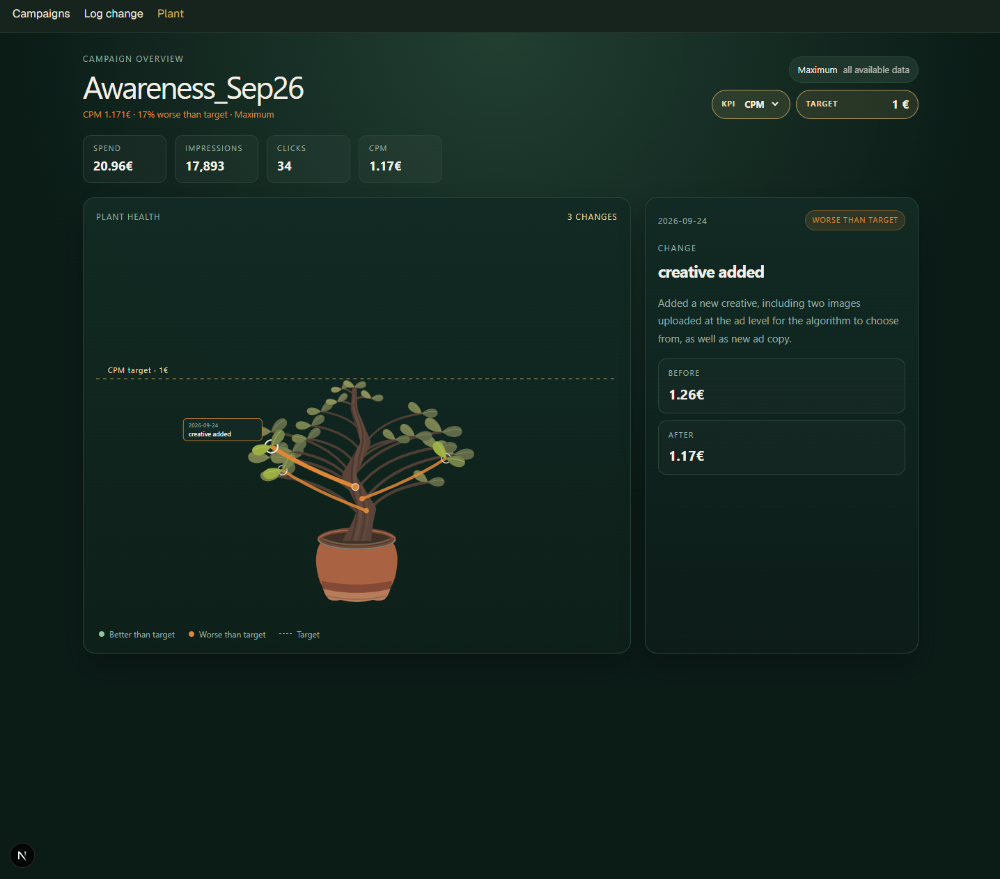

# Meta-Plant

A growing campaign changelog. Meta-Plant visualizes the optimization history of a Meta Ads campaign as a plant: each logged optimization forms a branch, and the branch color indicates its health based on the campaign’s performance as a result of the optimization. 

 


## Why

In paid social, optimizations are often tracked in a spreadsheet, and people open a separate tab to check if a change worked. Meta-Plant puts the change and its effect in one picture.

## Features

- Daily automatic sync of campaign performance from the Meta Marketing API
- Form to log an optimization (type, date, comment, KPI before and after)
- Date range picker (Today, Yesterday, Last 7 days, Last 30 days, This month, Last month, custom): the totals, KPI status, plant, and changes follow the chosen period
- Plant view: each branch is one optimization. Sage = better than target, orange = worse, dashed gold line = KPI target
- Live KPI status with the distance to target, taken from the latest sync
- Editable campaign KPI settings on the plant page: choose CPC, CPM, CPV, or CPA and save a euro target
- CPV and CPA selections show no live value until video-view or conversion data is available
- Email alert when the last 3 days are worse than the KPI target (sent once, until it recovers)
- Playwright smoke tests

## How it works

```
Meta Marketing API
        |
GitHub Actions (daily, 06:00 UTC)
        |
sync-campaigns.js  -->  Supabase (Postgres)  -->  Next.js pages
        |
check-kpi.js  -->  alert email (Resend)
```

## Tech stack

Next.js (App Router, TypeScript), Supabase, Meta Marketing API, GitHub Actions, Resend, Playwright.

## Project structure

```
.github/workflows/sync-campaigns.yml   daily sync + KPI check
sync-campaigns.js                      pulls Meta data into Supabase
check-kpi.js                           sends an alert email if the KPI is below target
fetch-campaigns.js                     read-only API test script
webapp/                                Next.js app (/campaigns, /changes, /tree)
webapp/tests/                          Playwright tests
```

## Data model

Three tables: `campaigns` (KPI metric and target), `insight_snapshots` (one row per campaign and day), `changes` (logged optimizations). Row Level Security is enabled; the app reads and writes on the server only.

## Run locally

Needs Node 22+, a Supabase project, and a Meta system user token with `ads_read`.

Environment variables:

```
META_ACCESS_TOKEN
SUPABASE_URL
SUPABASE_SERVICE_ROLE_KEY   (the Supabase secret key)
RESEND_API_KEY
ALERT_EMAIL_TO
```

```
npm install
node sync-campaigns.js
cd webapp
npm install
npm run dev
```

## Tests

```
cd webapp
npx playwright install chromium
npm test
```

The six smoke tests cover page navigation, the campaign list, the plant page with its KPI settings, KPI target validation, form validation, and the date range picker. None of them writes data.

## Notes

- Built with a personal test ad account and test campaign.
- Internal prototype: there is no login yet, so do not deploy it publicly as it is.
- Next: AI-written trend summary per campaign, more tests (form submit, alert logic).